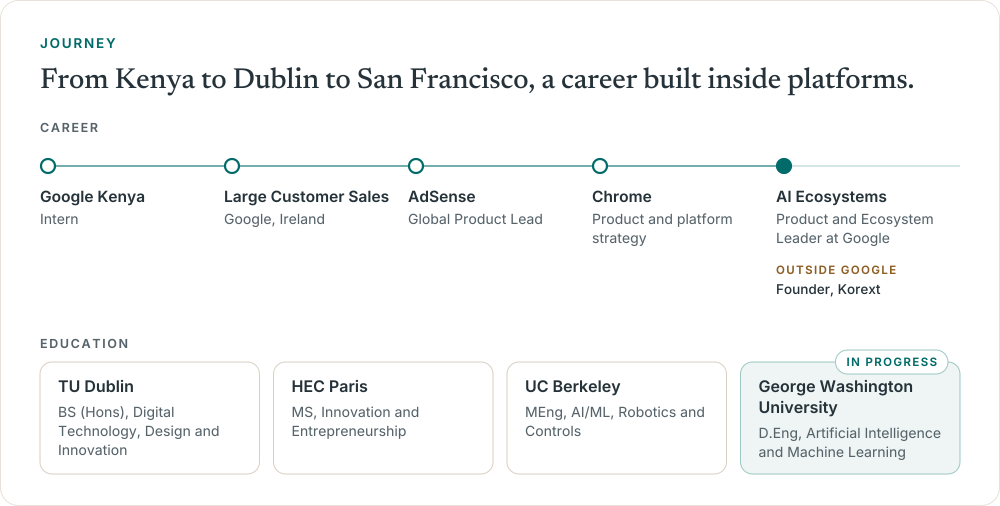

  

  

<b>AI CODE GOVERNANCE</b> &nbsp;·&nbsp; <b>OPEN STANDARDS</b> &nbsp;·&nbsp; <b>SIGNED PROOF</b>

<a href="#about">About</a> &nbsp;·&nbsp; <a href="#korext-the-stack">Stack</a> &nbsp;·&nbsp; <a href="#korext-open-standards">Open standards</a> &nbsp;·&nbsp; <a href="#korext-platform">Platform</a> &nbsp;·&nbsp; <a href="#career">Career</a> &nbsp;·&nbsp; <a href="#connect">Connect</a>

 

## About

I founded **[Korext](https://korext.github.io)** to make AI written code accountable. AI coding tools now write code faster than people can review it, and every team that adopts them has to answer the same questions: which code did AI write, did it meet our rules, and can we prove it? Korext answers with **[seven open standards](https://oss.korext.com)** that make AI written software traceable, licensable and accountable, and **[a platform](https://korext.com)** that enforces your policies where code is written and signs proof bundles for audit.

By day I am a Product and Ecosystem Leader in AI Ecosystems at Google. Korext is my own work, separate from Google.

 

<table>
<tr>
<td width="50%" valign="top">

01 &nbsp; OPEN SOURCE

### Korext Open Standards

Seven standards, from tracking which of 19 AI coding tools touched a repository to estimating the carbon cost of AI assisted commits. CC0 specifications, Apache 2.0 code, CC BY 4.0 data.

<a href="https://oss.korext.com"><b>oss.korext.com →</b></a>

</td>
<td width="50%" valign="top">

02 &nbsp; PLATFORM

### Korext Platform

72 policy packs and 532 rules across 13 languages, in the editor, the terminal, pull requests and AI assistants, with signed proof bundles for audit.

<a href="https://korext.com"><b>korext.com →</b></a>

</td>
</tr>
<tr>
<td width="50%" valign="top">

03 &nbsp; IN CI/CD

### Korext Enforce

A GitHub Action that scans every pull request, posts violations as Code Scanning annotations and fails the check on critical or high severity findings.

<a href="https://github.com/marketplace/actions/korext-enforce"><b>GitHub Marketplace →</b></a>

</td>
<td width="50%" valign="top">

04 &nbsp; DAY JOB

### AI Ecosystems at Google

How AI agents, platforms and publishers connect: access, identity, incentives and the protocols that hold them together.

<a href="https://tbrunoh.github.io"><b>tbrunoh.github.io →</b></a>

</td>
</tr>
</table>

 

## Korext: the stack

 

## Korext Open Standards

<table>
<thead>
<tr><th align="left">Role</th><th align="left">Standard</th><th align="left">What it does</th><th align="left">Start with</th><th align="left">Release</th></tr>
</thead>
<tbody>
<tr>
<td>TRACK</td>
<td><a href="https://github.com/korext/ai-attestation"><b>ai-attestation</b></a></td>
<td>Tracks AI generated code in a repository, across 19 AI coding tools</td>
<td><code>npx @korext/ai-attestation init</code></td>
<td></td>
</tr>
<tr>
<td>DECLARE</td>
<td><a href="https://github.com/korext/ai-license"><b>ai-license</b></a></td>
<td>Declares AI provenance with a notice that attaches to any license</td>
<td><code>npx @korext/ai-license generate</code></td>
<td></td>
</tr>
<tr>
<td>SCAN</td>
<td><a href="https://github.com/korext/supply-chain-attestation"><b>supply-chain-attestation</b></a></td>
<td>AI provenance across the dependency tree, in 14 ecosystems</td>
<td><code>npx @korext/supply-check scan</code></td>
<td></td>
</tr>
<tr>
<td>REPORT</td>
<td><a href="https://github.com/korext/ai-incident-registry"><b>ai-incident-registry</b></a></td>
<td>A public registry of AI code failures</td>
<td><code>npx @korext/incident-report draft</code></td>
<td></td>
</tr>
<tr>
<td>DETECT</td>
<td><a href="https://github.com/korext/ai-regression-database"><b>ai-regression-database</b></a></td>
<td>Code patterns AI tools keep getting wrong, with a scanner</td>
<td><code>npx @korext/regression-submit detect</code></td>
<td></td>
</tr>
<tr>
<td>MEASURE</td>
<td><a href="https://github.com/korext/ai-code-radar"><b>ai-code-radar</b></a></td>
<td>Public data and an API on AI code adoption in open source</td>
<td><code>npm install @korext/radar-data</code></td>
<td></td>
</tr>
<tr>
<td>SUSTAIN</td>
<td><a href="https://github.com/korext/commit-carbon"><b>commit-carbon</b></a></td>
<td>The carbon footprint of AI assisted commits, for CSRD, SEC and CDP reports</td>
<td><code>npx @korext/commit-carbon scan</code></td>
<td></td>
</tr>
</tbody>
</table>

Specifications CC0 &nbsp;·&nbsp; Code Apache 2.0 &nbsp;·&nbsp; Data CC BY 4.0 &nbsp;·&nbsp; Built so anyone can adopt, extend and contribute back without legal friction.

  

## Korext Platform

<table>
<thead>
<tr><th align="left">Where you work</th><th align="left">How to get it</th></tr>
</thead>
<tbody>
<tr><td><b>VS Code</b></td><td><a href="https://marketplace.visualstudio.com/items?itemName=Korext.korext">Visual Studio Marketplace</a></td></tr>
<tr><td><b>Cursor and Windsurf</b></td><td><a href="https://open-vsx.org/extension/Korext/korext">Open VSX</a></td></tr>
<tr><td><b>JetBrains IDEs</b></td><td><a href="https://plugins.jetbrains.com/plugin/30716-korext">JetBrains Marketplace</a></td></tr>
<tr><td><b>Terminal</b></td><td><code>npm install -g korext</code></td></tr>
<tr><td><b>Pull requests</b></td><td><a href="https://github.com/marketplace/actions/korext-enforce">Korext Enforce</a> on GitHub Marketplace</td></tr>
<tr><td><b>Chrome</b></td><td><a href="https://chromewebstore.google.com/detail/korext-ai-code-governance/binigmpigofmlbcpacfknghdilflhccl">Chrome Web Store</a></td></tr>
<tr><td><b>AI assistants</b></td><td><a href="https://korext.com/mcp">MCP</a>, with five tools from policy directives to proof bundles</td></tr>
</tbody>
</table>

 

## Career

 

Born and raised in Kenya. More than a decade at Google, including five years shaping product and platform strategy for Chrome, used by billions of people. I invest in technology led founders in frontier markets with Black Angel Group and advise Silicon Xchange, which connects Silicon Valley and Africa.

 

## Connect

 

---

<i>The next decade of software gets written faster than humans can review it. Infrastructure for accountability has to ship at the same pace as the agents producing the code.</i>

