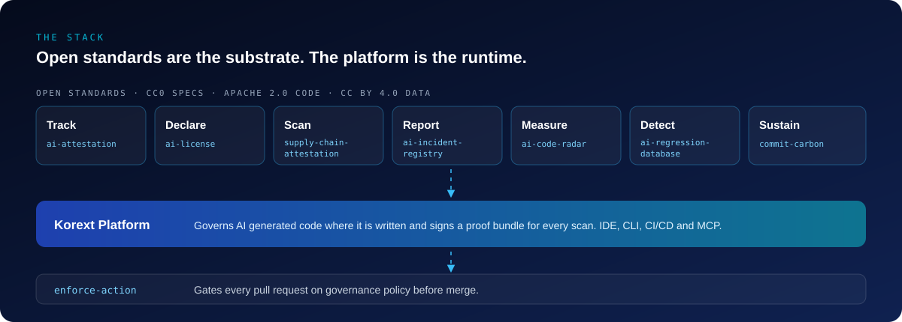

  

  

<b>AI ECOSYSTEMS</b> &nbsp;·&nbsp; <b>OPEN STANDARDS</b> &nbsp;·&nbsp; <b>SOFTWARE ACCOUNTABILITY</b>

 

## About

I work where AI systems meet the ecosystems around them: the agents, platforms, publishers and developers that have to trust one another for any of it to work.

By day I am a Product and Ecosystem Leader in AI Ecosystems. Outside of it I build **[Korext](https://korext.com)**, a governance runtime for AI generated code, and lead **[Korext Open Source](https://oss.korext.com)**, seven open standards that make AI written software traceable, licensable and accountable.

 

<table>
<tr>
<td width="33%" valign="top">

01 &nbsp; DAY JOB

### AI Ecosystems

How agents, platforms and publishers connect: access, identity, incentives and the protocols that hold them together.

</td>
<td width="33%" valign="top">

02 &nbsp; OPEN SOURCE

### Korext Standards

Seven open standards for AI code provenance. CC0 specifications, Apache 2.0 code, CC BY 4.0 data.

<a href="https://oss.korext.com"><b>oss.korext.com →</b></a>

</td>
<td width="33%" valign="top">

03 &nbsp; COMPANY

### Korext Platform

The runtime that enforces those standards for regulated industries, with a signed proof bundle for every scan.

<a href="https://korext.com"><b>korext.com →</b></a>

</td>
</tr>
</table>

 

## The Stack

 

## Open Standards

<table>
<thead>
<tr><th align="left">Role</th><th align="left">Standard</th><th align="left">What it does</th><th align="left">Release</th></tr>
</thead>
<tbody>
<tr>
<td>TRACK</td>
<td><a href="https://github.com/korext/ai-attestation"><b>ai-attestation</b></a></td>
<td>Verifiable provenance for the leading AI coding tools</td>
<td></td>
</tr>
<tr>
<td>DECLARE</td>
<td><a href="https://github.com/korext/ai-license"><b>ai-license</b></a></td>
<td>Licensing framework for AI generated code</td>
<td></td>
</tr>
<tr>
<td>SCAN</td>
<td><a href="https://github.com/korext/supply-chain-attestation"><b>supply-chain-attestation</b></a></td>
<td>AI provenance across SBOM and signature ecosystems</td>
<td></td>
</tr>
<tr>
<td>REPORT</td>
<td><a href="https://github.com/korext/ai-incident-registry"><b>ai-incident-registry</b></a></td>
<td>Public incident taxonomy and registry for AI code failures</td>
<td></td>
</tr>
<tr>
<td>MEASURE</td>
<td><a href="https://github.com/korext/ai-code-radar"><b>ai-code-radar</b></a></td>
<td>Detection pattern library and live adoption data for AI authored code</td>
<td></td>
</tr>
<tr>
<td>DETECT</td>
<td><a href="https://github.com/korext/ai-regression-database"><b>ai-regression-database</b></a></td>
<td>Regression fingerprinting for AI code patterns</td>
<td></td>
</tr>
<tr>
<td>SUSTAIN</td>
<td><a href="https://github.com/korext/commit-carbon"><b>commit-carbon</b></a></td>
<td>Emissions accounting for software changes</td>
<td></td>
</tr>
</tbody>
</table>

Specifications CC0 &nbsp;·&nbsp; Code Apache 2.0 &nbsp;·&nbsp; Data CC BY 4.0 &nbsp;·&nbsp; Built so anyone can adopt, extend and contribute back without legal friction.

  

## Background

More than a decade at Google, from Large Customer Sales and Global Product Lead for AdSense to five years shaping product and platform strategy for Chrome, used by billions of people. Born and raised in Kenya, I invest in technology led founders in frontier markets with Black Angel Group and advise Silicon Xchange, which connects Silicon Valley and Africa.

 

 

## Activity

<picture>
  <source media="(prefers-color-scheme: dark)" srcset="https://stats.oss.korext.com/api?username=tombruno-korext&show_icons=true&count_private=true&include_all_commits=true&hide_border=true&title_color=7DD3FC&icon_color=06B6D4&text_color=C9D1D9&bg_color=0D1117">
  
</picture>
<picture>
  <source media="(prefers-color-scheme: dark)" srcset="https://stats.oss.korext.com/api/top-langs/?username=korext&layout=compact&hide_border=true&title_color=7DD3FC&text_color=C9D1D9&bg_color=0D1117">
  
</picture>

  

<picture>
  <source media="(prefers-color-scheme: dark)" srcset="https://github-readme-activity-graph.vercel.app/graph?username=tombruno-korext&hide_border=true&bg_color=0D1117&color=7DD3FC&line=06B6D4&point=FFFFFF&area=true&area_color=06B6D4">
  
</picture>

 

## Connect

 

---

<i>The next decade of software gets written faster than humans can review it. Infrastructure for accountability has to ship at the same pace as the agents producing the code.</i>

